<div align="center">

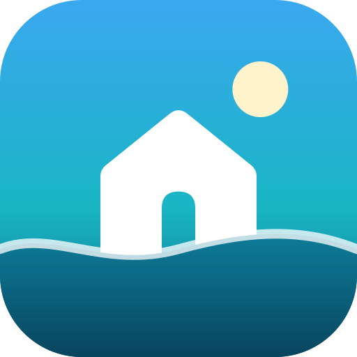

# MoLakaz TV

**An ad-free home screen for Android TV boxes, with nature films playing behind your apps.**

No sponsored rows, no account, about 1 MB. Open source, built with Claude Code. One press puts the TV's own home screen
back.

[**Download**](https://github.com/benosss/molakaz-tv/releases/latest) · [Install](#install) · [What it does](#what-it-does) · [Watch the film](https://benosss.github.io/molakaz-tv/film.html) · [Set-up guide (PDF)](docs/MoLakaz-TV-Setup-Guide.pdf) · [Make your own](#make-your-own)

<a href="https://benosss.github.io/molakaz-tv/film.html">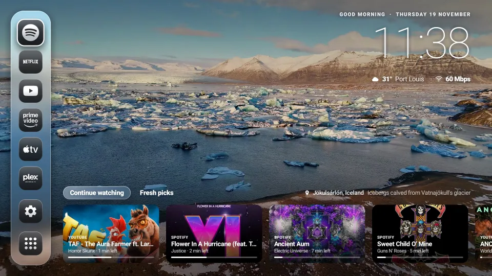</a>

<sub>Real screens, captured on the TV. <a href="https://benosss.github.io/molakaz-tv/film.html">Watch the 40-second film</a>.</sub>

</div>

## Why I made this

The home screen on my TV box was mostly things I never asked for: rows of sponsored shows, banners, apps I'd never
open. I wanted the opposite. Something nice to look at when nothing's playing, that remembers what I was in the middle
of and gets out of the way.

The idea of swapping the home screen for an ad-free one that you can undo with one press comes from
[Free My TV](https://github.com/simbasjungles/free-my-tv) by simbasjungles. Have a look at it too, especially on a
Google TV, LG or Samsung TV. MoLakaz TV takes the idea in another direction: films instead of posters, previews when you
rest on a card, and a set-up that runs from a USB stick, so friends and family can have it without a laptop.

I built it with [Claude Code](https://claude.com/claude-code), Anthropic's coding agent, and it did a lot of the heavy
lifting: the GL glass, the film pipeline, the song scenes, the 28 languages and the LG and Samsung version. I decided
what it should be and how it should feel, tested every change on the TV, and sent things back until they were right.

## What it does

<table>
<tr>
<td width="50%" valign="top">
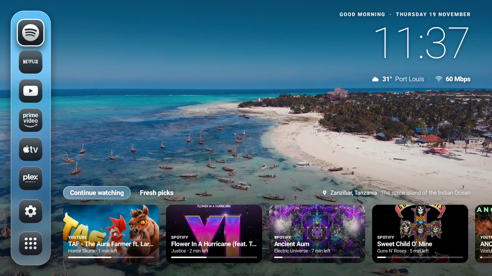
<h3>Films behind your apps</h3>
27 films of real places (Manali, Zanzibar, Jökulsárlón, Bali, Cape Town and more), smoothed to 60 fps, fade from one to
the next behind your apps. Each one names its place with a line about it, and the glass bar picks up the colours of
the film behind it.
</td>
<td width="50%" valign="top">
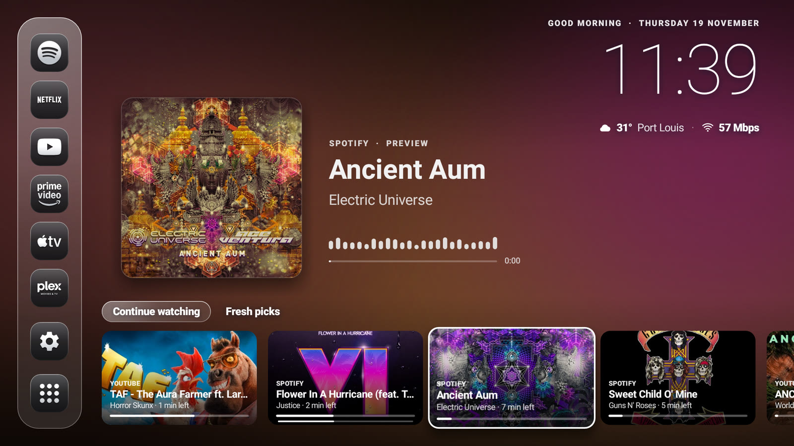
<h3>Spotify songs</h3>
Rest on a Spotify card and the screen turns into the song: its cover, its colours, and a 30-second clip with a
visualiser. If it's the song that's already playing, you see its real progress instead. A clip never plays over your
music.
</td>
</tr>
<tr>
<td valign="top">
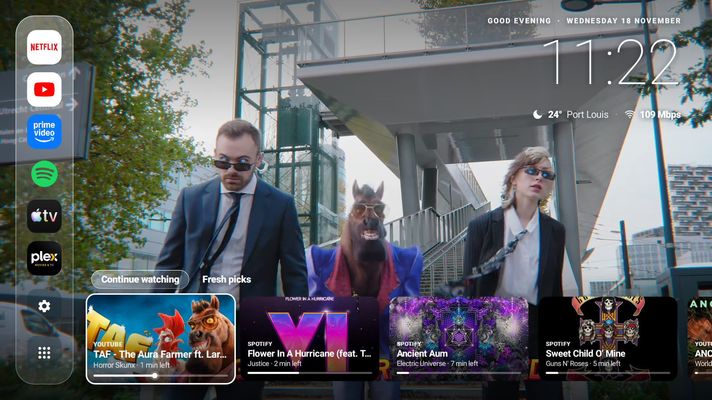
<h3>Video previews</h3>
Rest on a YouTube card and the video starts behind Home at 1080p, from where you stopped. OK opens it in YouTube at the
same second. Netflix titles play their trailer.
</td>
<td valign="top">

<h3>Icons that match</h3>
The apps on the bar are redrawn as white marks on dark glass, so they look like one set. Tinted glass in each app's
colour, or the original icons, are one switch away in Settings.
</td>
</tr>
<tr>
<td valign="top">

<h3>Continue watching and Fresh picks</h3>
One row for what you were in the middle of on Netflix, YouTube and Spotify. One for what's new: Netflix's Top 10 where
you live, YouTube trending and New Music Friday, refreshed twice a day. No API keys.
</td>
<td valign="top">
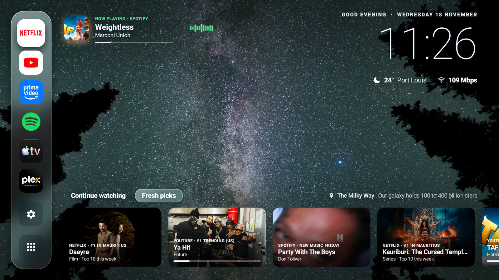
<h3>Now playing</h3>
Music playing in the background shows at the top with its cover and a live visualiser. Play, pause and skip from the
remote or your phone.
</td>
</tr>
<tr>
<td valign="top">

<h3>Your phone as a remote</h3>
Scan a QR code once and your phone gets a touchpad, a keyboard for typing, volume and the sleep timer. Nothing to
install: it's a web page you can pin to your home screen.
</td>
<td valign="top">
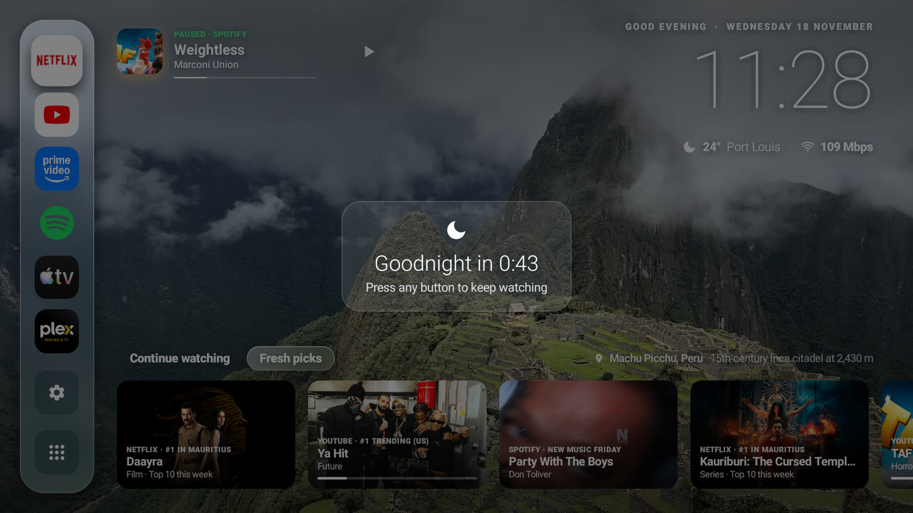
<h3>Sleep timer</h3>
Fades the sound and dims the picture over whatever app is open, then puts the TV to sleep. Once, or every night.
</td>
</tr>
<tr>
<td valign="top">
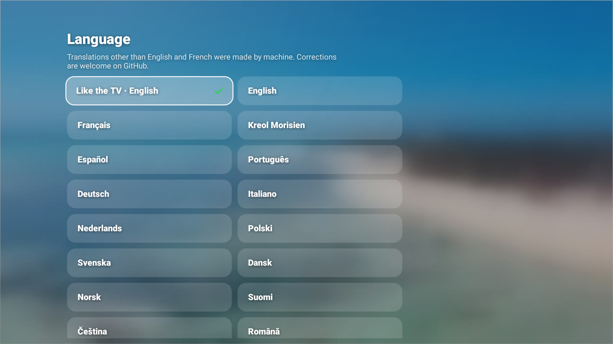
<h3>28 languages</h3>
English, French, Kreol Morisien, Spanish, Portuguese, German, Japanese, Korean, Chinese, Hindi and 18 more. It follows
the TV's language, or you pick one.
</td>
<td valign="top">
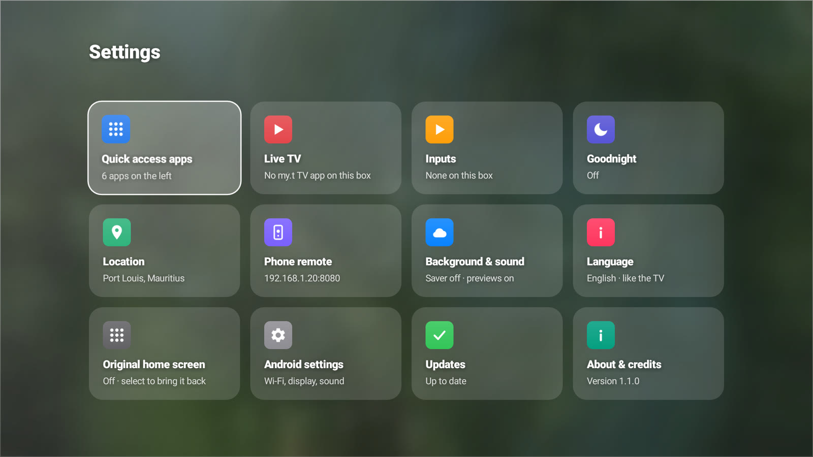
<h3>Updates and a safety net</h3>
It updates itself from this repo's releases (checksum and signature checked). If it ever crashed three times in five
minutes, the TV's original home screen would come back on its own. HDMI inputs can go on the bar too.
</td>
</tr>
<tr>
<td valign="top">

<h3>Set up from a USB stick</h3>
Install it, press OK, and it does the rest: permissions, your apps, the films and the Home button. No computer. The
<a href="docs/MoLakaz-TV-Setup-Guide.pdf">set-up guide</a> is seven pages with pictures.
</td>
<td valign="top">

<h3>Day and night</h3>
The glass darkens after your town's sunset. Ambient sound is optional: birds at dawn, waves by day, rain when it
rains.
</td>
</tr>
</table>

<p align="center"></p>
<p align="center"><sub>The 27 films. The people who shot them are credited in <a href="CREDITS.md">CREDITS.md</a>.</sub></p>

## Install

### Android TV and Google TV

You need a TV or box on Android 8 or newer with about 600 MB free (the films are 420 MB). I test on an older Android 8
box, so newer ones should be fine; reports are welcome either way.

- **Just the app:** download `MoLakaz-TV.apk` from the [latest release](https://github.com/benosss/molakaz-tv/releases/latest)
  and open it on the TV with a file manager (X-plore, Downloader or similar). On first run it downloads the films and
  sets itself up. After that it updates itself.
- **With a USB stick, no computer:** the easiest way to set up a friend's or a parent's TV. Follow the
  [set-up guide (PDF)](docs/MoLakaz-TV-Setup-Guide.pdf); [`kit/make_usb_kit.sh`](kit/make_usb_kit.sh) prepares the stick.
- **With an AI coding assistant:** turn on USB debugging on the TV (Settings > About > press Build 7 times, then
  Developer options > USB debugging), open [Claude Code](https://claude.com/claude-code) on a computer on the same
  Wi-Fi, and say:
  > Install MoLakaz TV (github.com/benosss/molakaz-tv) on my TV at 192.168.1.20.

  It downloads the release, connects to the TV and installs it, and asks before anything important. Then press OK on
  the TV to finish.
- **From a computer:**
  ```bash
  adb connect 192.168.1.20:5555          # your TV's IP (Settings > Network)
  adb install -r MoLakaz-TV.apk
  adb shell am start -n com.lagoon.home/.HomeActivity
  ```
  Then press OK on the TV to finish.

**Going back:** Settings > Original home screen brings the TV's own launcher back. MoLakaz TV only switches it off and
never uninstalls anything.

### LG and Samsung TVs (preview)

The same home screen as a small web app for LG webOS (2016 and newer) and Samsung Tizen (2017 and newer): the films,
the glass bar of your apps, the clock and weather, Fresh picks, Inputs (HDMI 1 to 4, Live TV), All apps and Settings.
On these TVs it's an app you open from the TV's own bar, because neither lets an app replace the home screen.

<p align="center">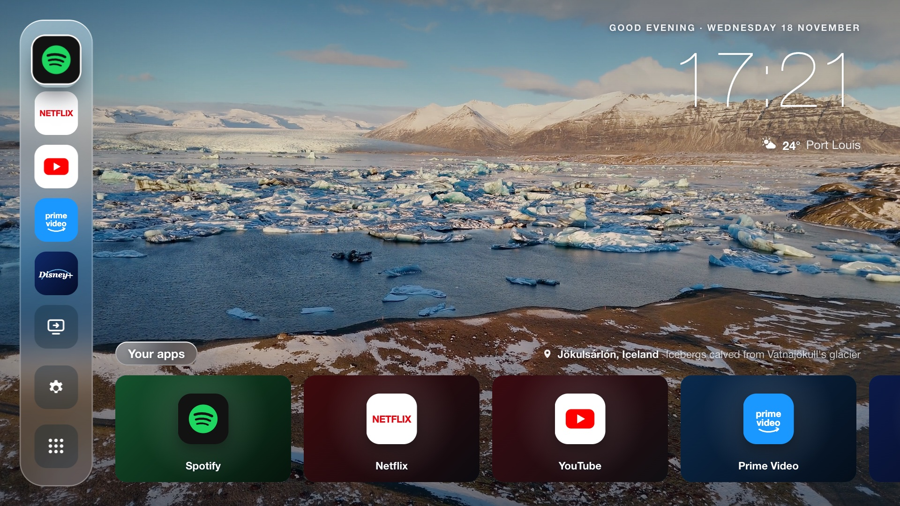 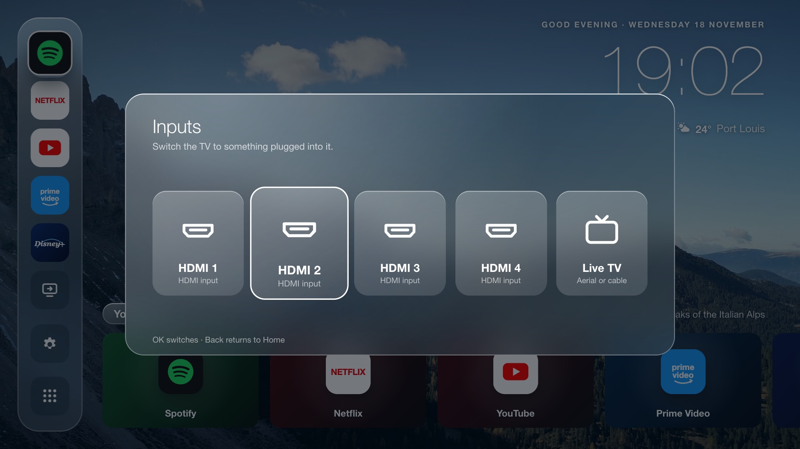</p>

- **LG:** get `MoLakazTV-webos.ipk` from the [latest release](https://github.com/benosss/molakaz-tv/releases/latest)
  and install it in Developer Mode with LG's `ares-install` or the webOS Dev Manager app. Steps in [`webos/`](webos).
- **Samsung:** `MoLakazTV-tizen.wgt` from the release has to be signed for your TV with Tizen Studio, or loaded
  through TizenBrew. Steps in [`tizen/`](tizen).

I haven't been able to try it on a real LG or Samsung TV yet, so please tell me how it goes in
[Issues](https://github.com/benosss/molakaz-tv/issues), good or bad.

## Make your own

Fork it, change it, rename it, put it on your family's TVs. It's MIT licensed, so you don't need to ask: keep the
LICENSE file with your copy and that's it. If you build something on top of it, I'd really like to see it. Open an
issue and show me.

The quickest way to change it is to ask. Clone the repo, open [Claude Code](https://claude.com/claude-code) in it and
say what you want. It finds its way around the code, builds it, and can put it on your TV over adb. Try:

- *"Add Crunchyroll to the bar and give its cards their own colour."*
- *"Use the videos in ~/Videos as the films, and make the glass keyframes for them."*
- *"Rename it to Casa TV and use this logo."*
- *"Add Catalan."*
- *"Show the temperature in Fahrenheit."*
- *"Build it and install it on my TV at 192.168.1.20."*

If you'd rather find your own way, here's where things are:

- **The apps on the bar** and their order: [`Apps.kt`](app/app/src/main/java/com/lagoon/home/Apps.kt).
- **The films:** each one is an MP4 plus blurred keyframes for the glass, listed in [`films/scenes.json`](films/scenes.json).
  The keyframes come from
  `ffmpeg -i film.mp4 -vf "fps=2:round=up,scale=480:270:flags=area,gblur=sigma=10" -q:v 2 blur/<name>/k%04d.jpg`.
  First-run set-up downloads them as a zip from the address in [`Setup.kt`](app/app/src/main/java/com/lagoon/home/Setup.kt)
  (`FILMS_URL`), so point it at your own release.
- **The name:** `android:label` in [`AndroidManifest.xml`](app/app/src/main/AndroidManifest.xml), and `applicationId`
  in [`build.gradle.kts`](app/app/build.gradle.kts) so your version installs next to this one.
  [`Updater.kt`](app/app/src/main/java/com/lagoon/home/Updater.kt) checks this repo for new versions: point it at yours.
- **The look:** [`Ui.kt`](app/app/src/main/java/com/lagoon/home/Ui.kt) (sizes, motion),
  [`Glass.kt`](app/app/src/main/java/com/lagoon/home/Glass.kt) (the frosted bar) and
  [`GlassIcon.kt`](app/app/src/main/java/com/lagoon/home/GlassIcon.kt) (the icons).
- **A language:** copy a file in [`assets/i18n`](app/app/src/main/assets/i18n), translate the values, and run
  [`tools/i18n/check.py`](tools/i18n/check.py).
- **LG and Samsung:** [`web/`](web), plain HTML, CSS and JavaScript.

Build it with JDK 17 and the Android SDK: `cd app && ./gradlew assembleRelease`.

## How it works

A single Kotlin app with no UI framework. Every view is drawn by hand and sized for the GPUs inside TV boxes.

- **Three layers.** Films go straight to the hardware video plane. A translucent GL layer at 720p draws the glass and
  the dimming over it. While a preview plays, the rest of the interface is cached as one hardware layer.
- **Cross-fades with one video decoder.** The last frames of the outgoing film are kept as a GL texture while the
  decoder switches underneath, and the fade only starts once the new film is actually moving on screen.
- **Glass without a live blur.** Blurred keyframes are made ahead for every film and kept in sync with the picture, so
  the bar shows the colours behind it at no cost per frame.
- **The films.** Pexels footage, cut and cropped, interpolated to 60 fps with RIFE, tagged BT.709, with HEVC copies
  sized for the box.
- **YouTube previews** run in a WebView that loads the embed page directly, with injected CSS and JS: the player chrome
  is hidden, the stream is held at 1080p, letterboxing is detected on a canvas and cropped, and two players pre-load
  the cards you're likely to land on next.
- **Song scenes.** A track's clip and cover come from Spotify's public embed page, or the iTunes Search API for songs
  known only by name. The colours come from the cover, the visualiser reads Android's audio output, and the
  neighbouring cards' scenes are built ahead so the screen changes as soon as focus lands.
- **Glass icons from any app.** Each icon's mark is separated from its background (sampled just inside the edge, so
  rims and frames stay out), read at 256 px and redrawn in white at twice the size, then scaled down.
- **The TV's own adb, from inside the app** ([dadb](https://github.com/mobile-dev-inc/dadb) on `127.0.0.1:5555`): the
  first-run set-up, silent verified updates, the safety net and the phone remote's key helper go through it.

| Where | What |
|---|---|
| [`HomeActivity.kt`](app/app/src/main/java/com/lagoon/home/HomeActivity.kt) | The home screen: layers, focus, rows |
| [`Carousel.kt`](app/app/src/main/java/com/lagoon/home/Carousel.kt), [`Backdrop.kt`](app/app/src/main/java/com/lagoon/home/Backdrop.kt) | The films, their cross-fades, the GL glass |
| [`Preview.kt`](app/app/src/main/java/com/lagoon/home/Preview.kt), [`MusicPreview.kt`](app/app/src/main/java/com/lagoon/home/MusicPreview.kt) | Video previews and song scenes |
| [`GlassIcon.kt`](app/app/src/main/java/com/lagoon/home/GlassIcon.kt) | Glass icons |
| [`Setup.kt`](app/app/src/main/java/com/lagoon/home/Setup.kt), [`Updater.kt`](app/app/src/main/java/com/lagoon/home/Updater.kt), [`Safety.kt`](app/app/src/main/java/com/lagoon/home/Safety.kt) | First-run set-up, updates, the safety net |
| [`I18n.kt`](app/app/src/main/java/com/lagoon/home/I18n.kt), [`assets/i18n/`](app/app/src/main/assets/i18n) | Translations, one JSON file per language |
| [`web/`](web), [`webos/`](webos), [`tizen/`](tizen) | The LG and Samsung version |
| [`kit/`](kit) | The USB stick kit and the computer installers |

French and Kreol Morisien were translated by hand. The other 25 languages were machine-translated, so corrections from
native speakers are very welcome.

## Privacy

No accounts, no analytics, nothing sent about you. The TV talks to Open-Meteo (weather for your town), ipwho.is (your
town, once, if you haven't picked one), the public pages of Netflix, YouTube and Spotify (Fresh picks, trailers, song
clips), Apple's iTunes Search API (song clips) and GitHub (the films on first run, and new versions twice a day). The
phone remote only answers devices on your own network.

## Support

MoLakaz TV is free, with no ads and no tracking, and it will stay that way. If it made your TV nicer and you'd like to
say thanks, you can [buy me a coffee](https://paypal.me/benotron). Bug reports, translation fixes and photos of it
running on your TV help just as much.

## Credits

- [Free My TV](https://github.com/simbasjungles/free-my-tv) by simbasjungles, which this project was inspired by.
- The films are from [Pexels](https://www.pexels.com); everyone who shot them is listed in [CREDITS.md](CREDITS.md).
- Ambient sound from Wikimedia Commons, also listed in [CREDITS.md](CREDITS.md).

MoLakaz TV is not affiliated with Netflix, YouTube, Spotify, Amazon, Apple, Plex, Google, LG, Samsung or any TV
operator. App names and logos belong to their owners.

## License

[MIT](LICENSE)
