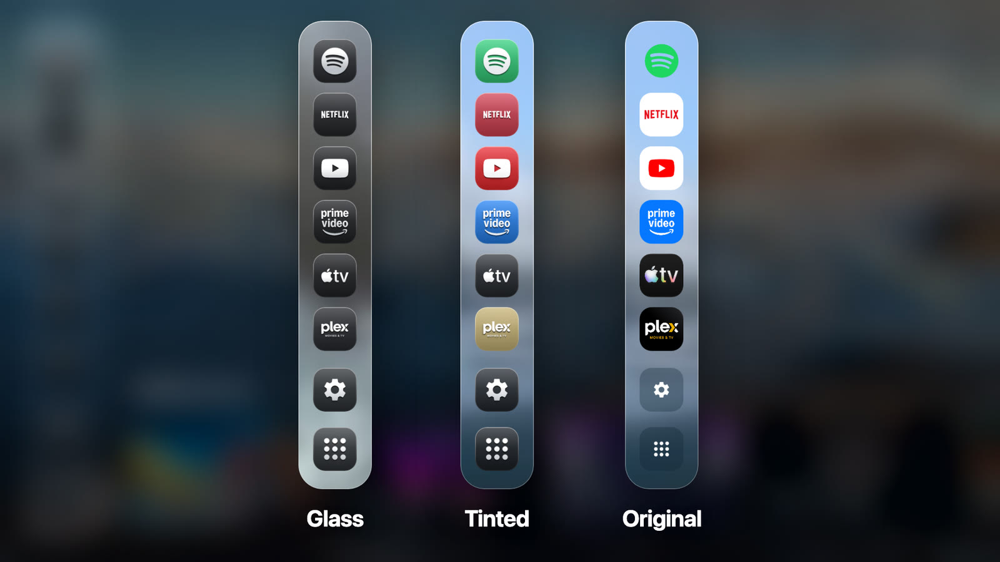
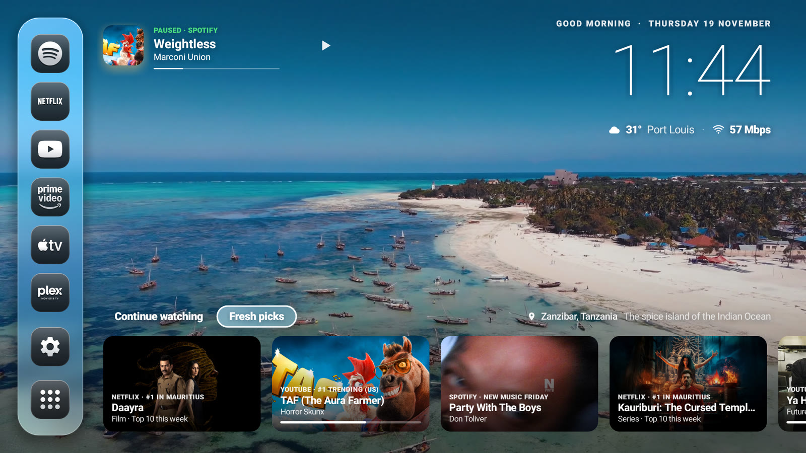
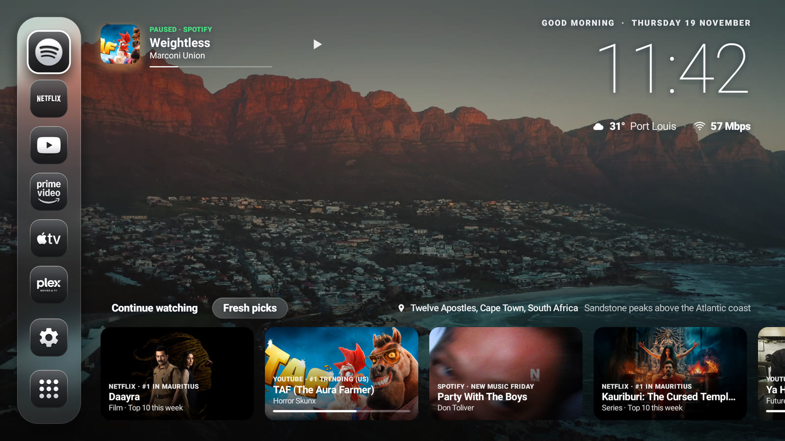

<div align="center">


# MoLakaz TV

**A beautiful, ad-free home screen for your TV.**

Cinematic nature films playing behind your apps, previews the moment you rest on a card, and nothing trying to sell
you anything. About 1 MB. No account. One press to undo.

[**Install**](#install) · [Features](#features) · [Watch the film](https://benosss.github.io/molakaz-tv/film.html) · [Set-up guide (PDF)](docs/MoLakaz-TV-Setup-Guide.pdf) · [Under the hood](#under-the-hood) · [Roadmap](ROADMAP.md)

[](https://github.com/benosss/molakaz-tv/releases/latest)
[](#install)
[](#lg-and-samsung-tvs-preview)
[](#why)
[](https://github.com/benosss/molakaz-tv/releases/latest)
[](#28-languages)
[](https://github.com/benosss/molakaz-tv/actions/workflows/build.yml)
[](LICENSE)

<a href="https://benosss.github.io/molakaz-tv/film.html"></a>

<sub>Real screens, straight from the TV. ▶ <a href="https://benosss.github.io/molakaz-tv/film.html">Watch the 40-second film</a>.</sub>

</div>

## Why

TV home screens were made to sell: sponsored rows, autoplaying promos, banners for things you never asked for. The
screen you look at most should be the calmest thing in the room.

<table>
<tr>
<td width="25%" valign="top"><b>🚫 Ad-free</b><br>No sponsored rows, no promos, no tracking. Your apps and what you were watching. That's it.</td>
<td width="25%" valign="top"><b>🪶 Lightweight</b><br>About 1 MB, drawn by hand for TV hardware. Smooth on a modest TV box with 2 GB of memory.</td>
<td width="25%" valign="top"><b>🏔️ Beautiful</b><br>27 cinematic nature films, smoothed to 60 fps, cross-fading behind everything like a window.</td>
<td width="25%" valign="top"><b>🌊 Immersive</b><br>Rest on a card and the whole screen becomes it: the video, the trailer, or the song.</td>
</tr>
</table>

## Features

<table>
<tr>
<td width="50%" valign="top">

<h3>A living background</h3>
Films of real places (Manali, Zanzibar, Jökulsárlón, Bali, Cape Town and 22 more) play behind your apps and cross-fade
from one to the next. Each names its place and tells you something about it, and the frosted glass follows the colours
of the film behind it.
</td>
<td width="50%" valign="top">

<h3>Songs come alive</h3>
Rest on a Spotify card and the screen becomes the song: its own colours glow and drift, the cover breathes with the
bass, the bars dance, and a 30-second clip fades in. Never over music that's already playing.
</td>
</tr>
<tr>
<td valign="top">

<h3>Rest on a card, it plays</h3>
YouTube videos start behind Home at 1080p, right where you left them, and open in the app from the same second.
Netflix titles play their trailer, found and pre-loaded for you.
</td>
<td valign="top">

<h3>Glass icons</h3>
Every app on the bar becomes a mark on frosted glass in its own colour, so Spotify, Netflix, YouTube and the rest look
like one family. Prefer the originals? One switch in Settings.
</td>
</tr>
<tr>
<td valign="top">

<h3>Continue watching &amp; Fresh picks</h3>
One row for what you were in the middle of on Netflix, YouTube and Spotify. One for what's new: Netflix's Top 10 in your
country, YouTube's trending and New Music Friday, twice a day. No API keys.
</td>
<td valign="top">

<h3>Now playing</h3>
Music in the background shows on Home with its cover and a live visualiser. Play, pause and skip from the remote or your
phone.
</td>
</tr>
<tr>
<td valign="top">

<h3>Your phone is the remote</h3>
Scan a code once: a touchpad, typing with the phone's keyboard, volume and the sleep timer. It saves to the phone's home
screen like an app. Nothing to install.
</td>
<td valign="top">

<h3>Goodnight</h3>
A sleep timer that fades the sound and dims the picture over any app, then puts the TV to sleep. Once, or every night.
</td>
</tr>
<tr>
<td valign="top">

<h3>28 languages</h3>
English, French, Kreol Morisien, Spanish, Portuguese, German, Japanese, Korean, Chinese, Hindi and 18 more. It follows
the TV, or pick one.
</td>
<td valign="top">

<h3>Looks after itself</h3>
It updates itself from GitHub (checked and verified), lists the TV's HDMI inputs, and if it ever crashed three times in
five minutes, the TV's original home screen would come back by itself.
</td>
</tr>
<tr>
<td valign="top">

<h3>Set up from a USB stick</h3>
Install it, press OK, and it sets itself up: permissions, your apps, the films and the Home button. No computer, no
command line. <a href="docs/MoLakaz-TV-Setup-Guide.pdf">The guide</a> fits on seven pages.
</td>
<td valign="top">

<h3>Day and night</h3>
The glass follows your town's real sunrise and sunset. Ambient sound is optional: birds at dawn, waves by day, rain when
it rains.
</td>
</tr>
</table>

<p align="center"></p>
<p align="center"><sub>The 27 films. Everyone who shot them is credited in <a href="CREDITS.md">CREDITS.md</a>.</sub></p>

### Compared with the TV's own home screen

| | Stock home screen | MoLakaz TV |
|---|:---:|:---:|
| Ads and sponsored rows | Yes | **None** |
| Background | Static banners | **27 nature films** |
| Previews on focus | Some apps | **Videos, trailers and songs** |
| Continue watching across apps | Partly | **Netflix, YouTube, Spotify** |
| Phone remote | Separate app | **Built in** |
| Sleep timer with fade-out | — | **Yes** |
| Set up without a computer | — | **Yes, from a USB stick** |
| Go back | — | **One press, nothing removed** |

## Install

### Android TV and Google TV

An Android TV box or TV on **Android 8 or newer**, with about 600 MB free (the films are 420 MB). Tested on a my.t 4K box
(HE2704).

- **Just the app:** download `MoLakaz-TV.apk` from the [latest release](https://github.com/benosss/molakaz-tv/releases/latest)
  and open it on the TV (X-plore, Downloader or any file manager). On first run it downloads the films and sets itself
  up. From then on it updates itself.
- **With a USB stick (no computer):** the way to set up a friend's or a parent's TV. Follow the
  [set-up guide (PDF)](docs/MoLakaz-TV-Setup-Guide.pdf); [`kit/make_usb_kit.sh`](kit/make_usb_kit.sh) makes the stick.
- **From a computer:**
  ```bash
  adb connect 192.168.1.20:5555          # your TV's IP (Settings › Network)
  adb install -r MoLakaz-TV.apk
  adb shell am start -n com.lagoon.home/.HomeActivity
  ```
  Then press OK on the TV to finish.

**Going back:** Settings › Original home screen brings the TV's own launcher back (MoLakaz TV only ever switches it off,
nothing is uninstalled).

### LG and Samsung TVs (preview)

The same home screen as a web app for LG webOS and Samsung Tizen TVs: the films, the glass bar of your apps, the clock
and weather, inputs and settings. It installs through each brand's Developer Mode; see [`webos/`](webos) and
[`tizen/`](tizen). It's new and hasn't been tried on many TVs yet: reports are very welcome.

## Under the hood

A single Kotlin app with no UI framework: every view is drawn by hand, sized for the GPUs inside TV boxes.

- **Three layers, one budget.** Films go straight to the hardware video plane. A translucent GL layer at 720p draws the
  glass and the dimming over it. While a preview plays, the whole interface is cached as one hardware layer.
- **Real cross-fades with one video decoder.** The last frames of the outgoing film are kept as a GL texture while the
  decoder switches underneath, and the fade only starts once the new film is really flowing on screen. The glass then
  follows the picture.
- **Glass that follows the film.** Blurred keyframes are pre-rendered for every film and kept in sync with the picture,
  so the frosted bar shows the colours behind it without a live blur.
- **A film pipeline.** Pexels footage → cut and cropped → frame-interpolated to 60 fps with RIFE → graded and tagged
  BT.709 → HEVC copies sized for the box.
- **YouTube previews in a WebView**, loaded as top-level embed pages with injected CSS and JS: the player chrome is
  hidden, the stream is held at 1080p, burned-in black bars are detected on a canvas and cropped, and two players
  pre-roll the cards you're likely to land on next.
- **Living song scenes.** A track's 30-second clip and cover come from Spotify's public embed page, or the iTunes Search
  API for songs known only by name. The colours are taken from the cover itself, the scene reacts to the music through
  Android's audio visualiser, and the neighbouring cards' scenes are built ahead so the screen changes the moment focus
  lands.
- **Glass icons from any app.** Each icon's mark is separated from its background (taken from the icon's edges) and
  redrawn in white on frosted glass tinted with the app's own colour.
- **The TV's own adb, from inside the app** ([dadb](https://github.com/mobile-dev-inc/dadb) on `127.0.0.1:5555`): the
  first-run set-up, silent verified updates, the safety net and the phone remote's key helper all go through it.

| Where | What |
|---|---|
| [`HomeActivity.kt`](app/app/src/main/java/com/lagoon/home/HomeActivity.kt) | The home screen: layers, focus, rows |
| [`Carousel.kt`](app/app/src/main/java/com/lagoon/home/Carousel.kt), [`Backdrop.kt`](app/app/src/main/java/com/lagoon/home/Backdrop.kt) | The films, their cross-fades, the GL glass |
| [`Preview.kt`](app/app/src/main/java/com/lagoon/home/Preview.kt), [`MusicPreview.kt`](app/app/src/main/java/com/lagoon/home/MusicPreview.kt) | Video previews; song scenes |
| [`GlassIcon.kt`](app/app/src/main/java/com/lagoon/home/GlassIcon.kt) | Glass icons |
| [`Setup.kt`](app/app/src/main/java/com/lagoon/home/Setup.kt), [`Updater.kt`](app/app/src/main/java/com/lagoon/home/Updater.kt), [`Safety.kt`](app/app/src/main/java/com/lagoon/home/Safety.kt) | First-run set-up, updates, the safety net |
| [`I18n.kt`](app/app/src/main/java/com/lagoon/home/I18n.kt), [`assets/i18n/`](app/app/src/main/assets/i18n) | Translations (one JSON file per language) |
| [`web/`](web), [`webos/`](webos), [`tizen/`](tizen) | The LG and Samsung version |
| [`kit/`](kit) | The USB stick kit and the computer installers |

Build it with JDK 17 and the Android SDK: `cd app && ./gradlew assembleRelease`.

## 28 languages

Each language is one file in [`assets/i18n`](app/app/src/main/assets/i18n), keyed by the English text.
[`tools/i18n/check.py`](tools/i18n/check.py) checks them all. English, French and Kreol Morisien were written by hand;
the others were machine-translated and corrections from native speakers are very welcome.

## Privacy

No accounts, no analytics, nothing sent about you. The TV talks to Open-Meteo (weather for your town), ipwho.is (your
town, once, if you haven't chosen one), Netflix, YouTube and Spotify's public pages (Fresh picks, trailers, song
previews), Apple's iTunes Search API (song previews), and GitHub (the films on first run, and new versions twice a
day). The phone remote only answers devices on your own network.

## Credits

Films from [Pexels](https://www.pexels.com) by the creators listed in [CREDITS.md](CREDITS.md). Ambient sound from
Wikimedia Commons. Inspired by [Free My TV](https://github.com/simbasjungles/free-my-tv).

MoLakaz TV is not affiliated with Netflix, YouTube, Spotify, Amazon, Apple, Plex, Google, LG, Samsung or any TV
operator. App names and logos belong to their owners.

## License

[MIT](LICENSE). ⭐ the repo if it made your TV a calmer place.
