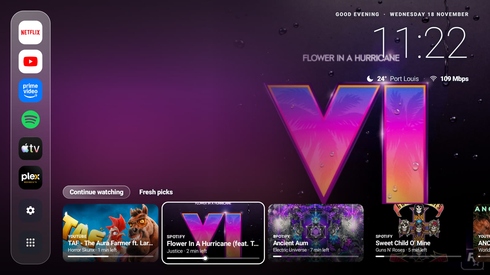
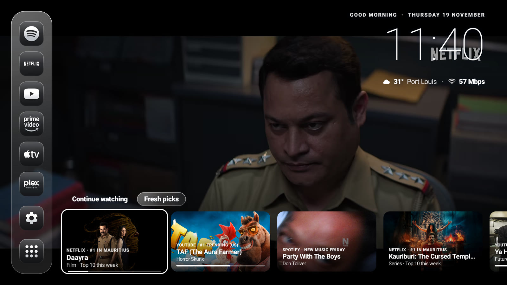
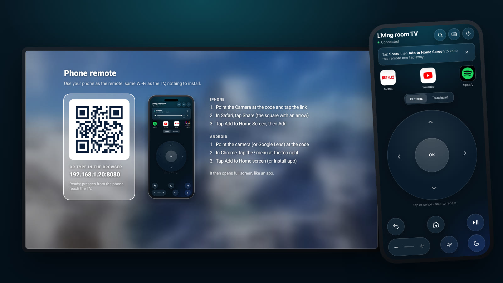
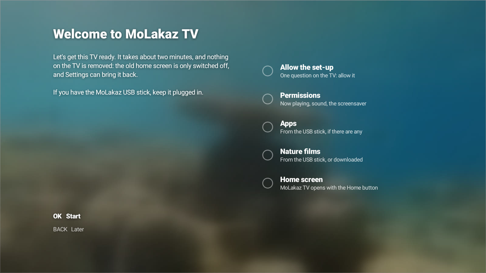
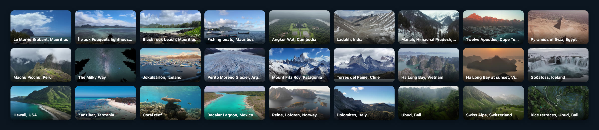

<div align="center">


# MoLakaz TV

**The home screen your Android TV box should have shipped with.**

Nature films that never stop moving, previews the moment you rest on a card, and your phone as a remote.<br>
No ads. No account. One press to undo.

[**Install**](#install) · [Features](#features) · [Set-up guide (PDF)](docs/MoLakaz-TV-Setup-Guide.pdf) · [Watch the film](https://benosss.github.io/molakaz-tv/film.html) · [Under the hood](#under-the-hood) · [Roadmap](ROADMAP.md)

[](https://github.com/benosss/molakaz-tv/releases/latest)
[](#install)
[](https://github.com/benosss/molakaz-tv/releases/latest)
[](https://github.com/benosss/molakaz-tv/actions/workflows/build.yml)
[](LICENSE)
[](#why)

<a href="https://benosss.github.io/molakaz-tv/film.html"></a>

<sub>Real screens from a my.t 4K box. ▶ <a href="https://benosss.github.io/molakaz-tv/film.html">Watch the 40-second film</a>.</sub>

</div>

## Why

TV boxes ship with home screens built to sell: sponsored rows, autoplaying promos, a wall of apps you never installed.
*Mo lakaz* means *my home* in Mauritian Creole, and that's the idea: the screen you see most should feel like yours.

MoLakaz TV replaces the box's launcher with a calm, fast one. A film of a real place plays behind everything, your apps
sit on a glass bar, and what you were watching is one press away. It was built for a second-hand my.t box in Mauritius
(Android 8, a Mali-450 GPU) and it is fast on it, so it is fast anywhere.

## Features

<table>
<tr>
<td width="50%" valign="top">

<h3>A living background</h3>
27 nature films from around the world, four of them from Mauritius, smoothed to 60 fps and cross-faded like a window.
Each one names its place and tells you something about it.
</td>
<td width="50%" valign="top">

<h3>Rest on a card, it plays</h3>
YouTube videos start behind Home at 1080p, right where you left them. Open the card and the app carries on from the
same second.
</td>
</tr>
<tr>
<td valign="top">

<h3>Songs, too</h3>
Spotify cards turn the screen into the song's cover, in its own colours, and play a 30-second clip. Never over music
that's already playing.
</td>
<td valign="top">

<h3>Trailers, found for you</h3>
Netflix's Top 10 in your country, with each title's trailer looked up and pre-loaded so it starts in a second or two.
</td>
</tr>
<tr>
<td valign="top">

<h3>Continue watching &amp; Fresh picks</h3>
One row for what you were in the middle of on Netflix, YouTube and Spotify. One for what's new: Netflix Top 10, YouTube
Charts and New Music Friday, refreshed every hour. No API keys.
</td>
<td valign="top">

<h3>Now playing</h3>
Music in the background shows on Home with its cover and a live visualiser. Play, pause and skip from the remote or your
phone.
</td>
</tr>
<tr>
<td valign="top">

<h3>Your phone is the remote</h3>
Scan a code once and the phone becomes a remote: a touchpad, typing with the phone's keyboard, volume, and the sleep
timer. It saves to the home screen like an app and finds the TV again by itself.
</td>
<td valign="top">

<h3>Goodnight</h3>
A sleep timer that fades the sound and dims the picture over any app, then pauses and puts the box to sleep. Once, or
every night at bedtime.
</td>
</tr>
<tr>
<td valign="top">

<h3>Set up from a USB stick</h3>
Install it, press OK, and it sets itself up: permissions, your apps, the films and the home button. No computer, no
command line. <a href="docs/MoLakaz-TV-Setup-Guide.pdf">The guide</a> fits on seven pages.
</td>
<td valign="top">

<h3>Day and night</h3>
The glass follows your town's real sunrise and sunset. Ambient sound is optional: birds at dawn, waves by day, rain when
it rains.
</td>
</tr>
</table>

<p align="center"></p>
<p align="center"><sub>The 27 films. Credits for every one are in <a href="CREDITS.md">CREDITS.md</a>.</sub></p>

### Compared with the box's own home screen

| | Stock Android TV home | MoLakaz TV |
|---|:---:|:---:|
| Ads and sponsored rows | Yes | **None** |
| Background | Static banners | **27 nature films** |
| Previews on focus | Some apps | **YouTube, trailers and songs** |
| Continue watching across apps | Partly | **Netflix, YouTube, Spotify** |
| Phone remote | Separate app | **Built in, no install** |
| Sleep timer with fade-out | — | **Yes** |
| Set up without a computer | — | **Yes, from a USB stick** |
| Go back | — | **One press, nothing removed** |

## Install

You need an Android TV box or TV on **Android 8 or newer** (tested on the my.t 4K box, HE2704) and about 600 MB free (the films are 420 MB).

### With a USB stick (no computer)

The easiest way, and the one for setting up friends and family. Follow the
**[set-up guide (PDF)](docs/MoLakaz-TV-Setup-Guide.pdf)**: install a file manager from Google Play, turn on USB
debugging, open `MoLakaz-TV.apk` from the stick, press OK. The stick needs a `MoLakaz` folder made by
[`kit/make_usb_kit.sh`](kit/make_usb_kit.sh), with the app, the films and (optionally) more apps to install.

### Just the app

Download `MoLakaz-TV.apk` from the **[latest release](https://github.com/benosss/molakaz-tv/releases/latest)** and
open it on the box (with X-plore, Downloader or any file manager). On first run it downloads the films from the release
and sets itself up.

### From a computer

```bash
adb connect 192.168.1.20:5555          # your box's IP (Settings › Network)
adb install -r MoLakaz-TV.apk
adb shell am start -n com.lagoon.home/.HomeActivity
```

Then press OK on the TV. The USB kit also has double-click installers for Windows and Mac in `MoLakaz/computer`.

### Going back

**Settings › Original home screen** switches the box's own launcher back on (MoLakaz TV only ever switches it off,
nothing is uninstalled). To remove MoLakaz TV, do that first, then uninstall it from Android's settings.

## Under the hood

MoLakaz TV is a single Kotlin app, under 1 MB, with no UI framework: every view is drawn by hand for a modest TV GPU.

- **Three layers, one budget.** Films go straight to the hardware video plane (no GPU work). A translucent GL layer at
  720p draws the glass and the dimming over it. While a preview plays, the whole interface is cached as one hardware
  layer, because redrawing it per video frame costs ~100 ms on a Mali-450.
- **Real cross-fades with one video decoder.** The box can only decode one film at a time, so the last frames of the
  outgoing film are kept as a GL texture while the decoder switches underneath, then dissolve away.
- **Glass that follows the film.** Blurred keyframes are pre-rendered at 2 fps for every film and kept in sync with
  the picture, so the frosted bar shows the colours behind it without a live blur.
- **A film pipeline.** Pexels footage → cut and cropped → frame-interpolated to 60 fps with RIFE → graded and tagged
  BT.709 → HEVC copies sized for the box.
- **YouTube previews in a WebView**, loaded as top-level embed pages with injected CSS and JS: the player chrome is
  hidden, the stream is held at 1080p, burned-in black bars are detected on a canvas and cropped, and two players
  pre-roll the cards you're likely to land on next.
- **Song previews without keys.** A Spotify track's 30-second clip and cover come from its public embed page; songs
  known only by name are matched with the iTunes Search API. Scenes are composed off the main thread and the
  neighbouring cards' are built ahead, so the screen changes the moment focus lands.
- **The box's own adb, from inside the app** ([dadb](https://github.com/mobile-dev-inc/dadb) on `127.0.0.1:5555`):
  that's how the first-run set-up grants permissions, switches the old launcher off, installs apps from a USB stick, and
  starts the key helper the phone remote talks to.
- **A phone remote with no app to install:** a small HTTP server on the box, a web app with a QR code to pair, and a
  tiny mDNS responder so the phone can find the TV by name.

| Where | What |
|---|---|
| [`HomeActivity.kt`](app/app/src/main/java/com/lagoon/home/HomeActivity.kt) | The home screen: layers, focus, rows |
| [`Carousel.kt`](app/app/src/main/java/com/lagoon/home/Carousel.kt), [`Backdrop.kt`](app/app/src/main/java/com/lagoon/home/Backdrop.kt) | The films and their cross-fades, the GL glass |
| [`Preview.kt`](app/app/src/main/java/com/lagoon/home/Preview.kt) | Video previews (YouTube, trailers) |
| [`MusicPreview.kt`](app/app/src/main/java/com/lagoon/home/MusicPreview.kt) | Song previews and their cover scenes |
| [`Data.kt`](app/app/src/main/java/com/lagoon/home/Data.kt), [`Picks.kt`](app/app/src/main/java/com/lagoon/home/Picks.kt) | Now playing, Continue watching, Fresh picks |
| [`Remote.kt`](app/app/src/main/java/com/lagoon/home/Remote.kt), [`remote.html`](app/app/src/main/assets/remote.html) | The phone remote |
| [`Setup.kt`](app/app/src/main/java/com/lagoon/home/Setup.kt) | The first-run set-up |
| [`Apps.kt`](app/app/src/main/java/com/lagoon/home/Apps.kt) | Known apps, and adding your own with `extra_apps.json` |
| [`kit/`](kit) | The USB stick kit and the computer installers |

Build it with JDK 17 and the Android SDK: `cd app && ./gradlew assembleRelease`.

## Privacy

No accounts, no analytics, nothing sent about you. The box talks to Open-Meteo (weather for your town), ipwho.is (your
town, once, if you haven't chosen one), Netflix, YouTube and Spotify's public pages (Fresh picks, trailers, song
previews), Apple's iTunes Search API (song previews), and GitHub (the films, on first run). The phone remote only
answers devices on your own network.

## Credits

Films from [Pexels](https://www.pexels.com) by the creators listed in [CREDITS.md](CREDITS.md). Ambient sound from
Wikimedia Commons. Inspired by [Free My TV](https://github.com/simbasjungles/free-my-tv).

MoLakaz TV is not affiliated with Netflix, YouTube, Spotify, Amazon, Apple, Plex, Google or Mauritius Telecom. App names
and logos belong to their owners.

## License

[MIT](LICENSE). Made in Mauritius 🇲🇺 — ⭐ the repo if it made your TV feel like home.
