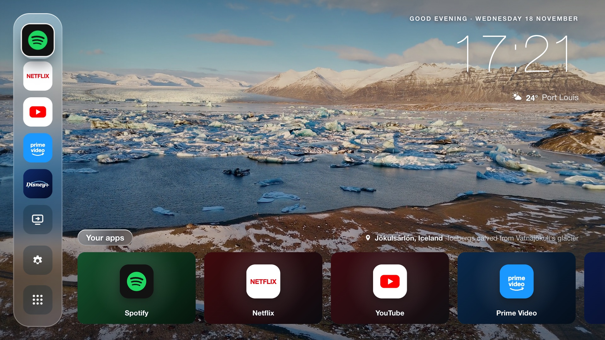
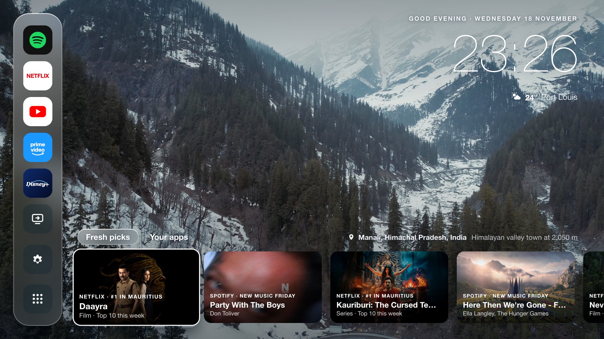
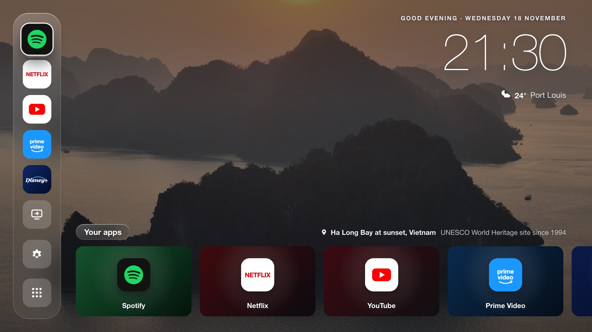
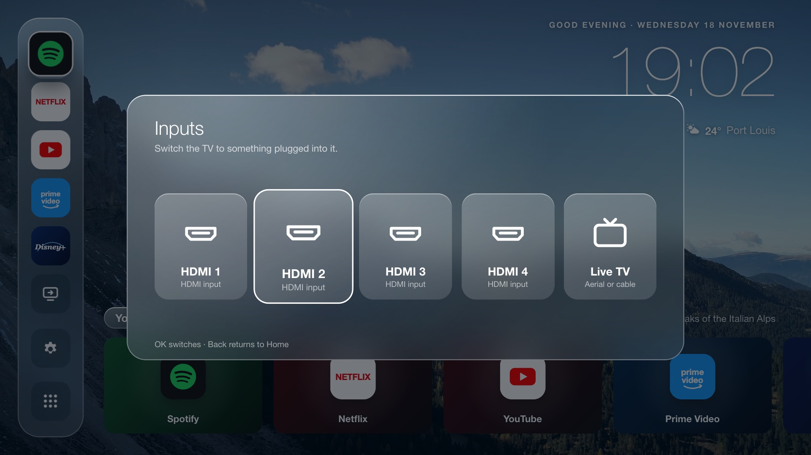
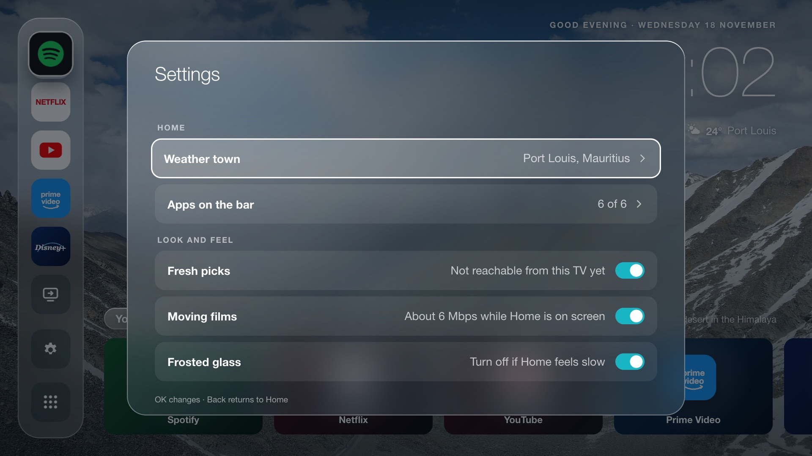

# MoLakaz TV on the web: LG webOS and Samsung Tizen

The same calm home screen as the Android TV app, as one small web app with no framework and no build step. It is
packaged for LG TVs by [`../webos`](../webos) and for Samsung TVs by [`../tizen`](../tizen).



| | |
|---|---|
|  |  |
|  |  |

## What it does

- **A film behind everything**: 27 nature films, muted, cross-faded every ~20 s, with the place and a line about it.
  Shuffled like the Android app: every film once per round, never the same film twice in a row, never two films from
  the same country back to back.
- **One decoder or two**: two `<video>` elements take turns. Many TVs decode one video at a time; when the second
  film shows no picture (twice, with data buffered, or a decode error), the TV is remembered as a one-decoder TV and
  films change by fading through the next film's still picture.
- **The glass bar**: up to six apps (Spotify first by default, then Netflix, YouTube, Prime Video, Disney+, Apple
  TV, Plex, whichever are installed), Inputs, Settings and All apps.
- **Clock, date and weather** for your town (Open-Meteo); the glass and dimming go darker from sunset to sunrise.
- **Fresh picks** (Netflix Top 10 in your country, YouTube Charts, Spotify's New Music Friday), refreshed twice a day
  and cached. If the TV's browser can't fetch them, the row shows your apps instead.
- **Inputs** (HDMI 1–4, Live TV), **All apps**, and **Settings**: weather town, the apps on the bar and their order,
  Fresh picks, moving films or still pictures (data saver), frosted glass, 24-hour clock.
- After 15 minutes without a key press the film on screen loops, so an idle TV stops downloading new films.

## Files

| File | What |
|---|---|
| `index.html`, `app.css` | The page, laid out on a 1280×720 grid and scaled to the TV |
| `platform.js` | The TV layer: webOS (luna), Tizen (`tizen.*`) or a browser stand-in; known app ids and their sources |
| `home.js` | Rail, row of cards, clock, weather line, place line, focus |
| `screens.js` | Inputs, All apps, Settings, spatial focus for those screens |
| `films.js` | Film list, shuffle, cross-fades, the one-decoder fallback |
| `weather.js`, `picks.js` | Open-Meteo weather and town search; Fresh picks |
| `main.js` | Start-up, remote keys, hiding/showing, idle |
| `scenes.json` | Built-in copy of the film list (the app first tries the one published on GitHub) |
| `img/apps/*.svg` | Stand-in icons for the known apps (the TV's own icons are used when it shares them) |
| `icons/` | App icons and the webOS splash, rendered from `docs/assets/icon.svg` by `icons/make_icons.py` |
| `preview/` | Screenshots and `shoot.py`, which takes them |

## Old TVs are the floor

webOS 3 runs Chromium 38 and Tizen 3 runs Chromium 47, so the code is ES5 (no arrow functions, `let`/`const`,
classes, template strings, promises or `fetch`; requests use `XMLHttpRequest`), CSS uses flexbox only (no grid, no
variables), and only `transform` and `opacity` animate. Frosted glass needs `backdrop-filter`; where the browser
lacks it, panels are plain translucent glass. Check before committing:

```bash
npx acorn --ecma5 --silent web/*.js     # parses as ES5, or says where it doesn't
```

## Preview on a computer

Open `index.html` in Chrome started with `--allow-file-access-from-files` (it reads `scenes.json` from disk). Arrow
keys, Enter and Esc stand in for the remote. Useful URL parameters:

| Parameter | Effect |
|---|---|
| `platform=browser` | Force the stand-in (also `webos`, `tizen`) |
| `films=<url or folder>/`, `stills=…` | Where `<name>.mp4` and `<name>.jpg` live (default: the GitHub release `films-v1`) |
| `film=jokulsarlon` | Start with this film |
| `now=2026-11-18T21:30`, `theme=day\|night` | Freeze the clock, force day or night |
| `focus=rail:2`, `screen=inputs\|apps\|settings`, `keys=down,ok` | Put focus somewhere, open a screen, press keys |
| `noguess=1`, `picks=0`, `scenes=scenes.json` | Don't guess the town from the IP, skip Fresh picks, use the built-in film list |
| `decoders=1` | Behave as a one-decoder TV |

The release's films are HEVC, which desktop Chrome may not play; point `films=` at H.264 copies. Screenshots:

```bash
python3 web/preview/shoot.py --films <folder of H.264 films> --stills <folder of stills> [--picks picks.json]
```

## Privacy

Same as the Android app: no accounts or analytics. The TV talks to GitHub (films and their list), Open-Meteo (weather
and town search), ipwho.is (your town, once, until you choose one), and Netflix, YouTube and Spotify's public pages
(Fresh picks).
